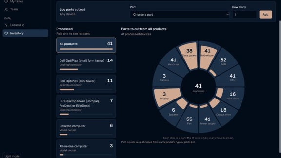
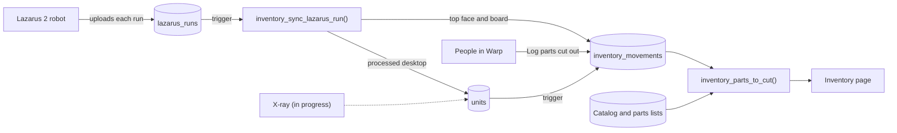

# Warp Inventory

An Inventory page for Warp, Andean's internal project and data app. Andean recycles e-waste: its Lazarus robot cuts desktops open so the circuit boards and other parts can be pulled out. The page shows how many devices have been processed, by product, and a wheel of the parts still to cut out of them. I built it at Andean with Claude Code, and it's live in Warp for the team.

**Demo:** https://emmagelman-alt.github.io/15-113-portoflio/warp-inventory/ (a working copy of the page with sample data)

## About this copy

Warp lives in Andean's private repository, so this folder is a copy of the inventory parts only, made for this class. Compared with the real code:

- The Supabase project address is replaced with `<project-ref>`.
- Test accounts use `@example.com` instead of Andean's email domain.
- The real Lazarus run counts in the starter catalog's notes are taken out.
- The demo uses made-up numbers. The real counts live in Andean's database.

The SQL builds on Warp's base schema (workspaces, members and Lazarus runs), which isn't included, so the code here is for reading rather than running on its own.

## Try the demo

1. Open the demo. It runs entirely in your browser, with no sign-in.
2. **Processed:** pick a product, like Dell OptiPlex (mini tower), or All products.
3. **Parts wheel:** each slice is a part, numbered with how many are expected inside the processed devices. The lit area grows as parts are cut. Hover or tap a slice to see "38 of 41 cut, 3 left" in the middle.
4. **Log parts cut out:** choose a part and a number and click Add. The wheel updates, and the parts count against the product you picked.
5. What you log is saved in your browser. **Reset the sample data** clears it. The sidebar button switches between Warp's light and dark themes.

## What it does

- **Catalog:** device categories (desktops, laptops, phones, monitors and more), device models, part types, and a typical parts list for each model or category. A starter catalog loads all of it with one click, including the three desktop models seen in Lazarus's run photos and what the photos show inside them.
- **Stock log:** every change is a new row in `inventory_movements`, a log that only grows. Counts are views over it, so a correction is a new row and the history is never edited.
- **Units:** one physical device, carrying a label through the X-ray and Lazarus. Marking a unit processed logs it as a processed device.
- **Fed by Lazarus 2:** each completed run becomes a processed desktop automatically. Each completed pick logs what came out: the case's top face, which Lazarus cuts off and drops in its scrap bin, and the board, which the operator lifts out. A re-sent run only logs the difference, a run marked failed takes its parts back out, and setting a model on a run's unit moves its parts to that model.
- **People log the rest:** the "Log parts cut out" form records parts taken out by hand.
- **The page:** processed devices by product, and a parts wheel for the one you pick.
- **Ready for the X-ray:** tables for X-ray scans, the components found in them, and labelled reference crops with vector embeddings (pgvector) for matching. A teammate is building the X-ray upload against the contract in [`code/docs/xray-ingest.md`](code/docs/xray-ingest.md).
- **Science team:** a table for the copper and gold recovered from each kind of part, for later.

## How it works

The wheel's numbers come from one database function, `inventory_parts_to_cut()`. It multiplies each product's processed count by its parts list to get the parts expected inside, and sums the recovered rows in the stock log to get the parts cut. The page groups those rows by product (`lib/inventory.ts`) and draws the wheel as plain SVG (`parts-wheel.tsx`).

## What's in this folder

| Path | What it is |
|---|---|
| `index.html`, `demo/` | The demo: the page's logic ported to plain JavaScript over sample data |
| `code/supabase/migrations/20261023180000_inventory.sql` | The schema: catalog, intake, units, X-ray scans, stock log, views, access rules |
| `code/supabase/migrations/20261023180100_inventory_starter_catalog.sql` | The starter catalog and the function that loads it |
| `code/supabase/migrations/20261026010000_inventory_lazarus_runs.sql` | The Lazarus 2 feed |
| `code/supabase/tests/` | Rolled-back SQL tests: 62 checks for the inventory, 16 for the Lazarus feed |
| `code/app/w/[workspaceId]/inventory/page.tsx` | The Next.js server page that loads the data |
| `code/components/inventory/` | The page's React components and the parts wheel |
| `code/lib/inventory.ts`, `code/lib/actions.ts` | Grouping logic, and the "log parts" and "load catalog" actions (an excerpt) |
| `code/docs/xray-ingest.md` | The X-ray upload contract for my teammate |

## Tech stack

- **Database:** Postgres on Supabase: tables, views, triggers, row-level security, and pgvector for the X-ray matching.
- **App:** Next.js (App Router) with React and TypeScript, Tailwind and shadcn/ui, in Warp's Andean palette. The wheel is hand-built SVG.
- **Tests:** SQL tests on a local Postgres 17 (PGlite), the same major version Supabase runs.
- **Demo:** plain HTML, CSS and JavaScript, on GitHub Pages.
- **Built with:** Claude Code. Every prompt is in [PROMPT_LOG.md](PROMPT_LOG.md).

## Security

- **Access:** row-level security keeps every row inside its workspace, and signed-out visitors see nothing. Members can read, add to the catalog and log parts. Only owners and admins can delete catalog entries or load the starter catalog, and entries still in use can only be archived.
- **The stock log only grows:** people can add rows but never edit or delete them, so every count can be traced back. Processed and received rows come only from the database's triggers.
- **Lazarus data:** only the database's own sync writes the rows that come from Lazarus runs. Members can't create rows that claim to be from a run.
- **Secrets:** no keys or tokens in the code. Machines like Lazarus upload with device tokens, which Warp stores only as hashes.

## How it was built

I planned it with Claude Code on October 23, 2026. Without the X-ray connected yet, Claude read the Lazarus 2 history in Warp with me signed in, so the starter catalog matches the desktops Andean actually processes. I compared three mockups of the page, picked the "pick a product" layout, and swapped the parts list for a wheel based on a reference image I liked. Claude wrote the migrations and tests, and I applied them to the live database. The X-ray upload went to a teammate. The page reached Warp's main branch on the night of October 25, and the Lazarus 2 feed followed the next morning.

[PROMPT_LOG.md](PROMPT_LOG.md) has every prompt, with a note on what came of each one.

**Next:** the wheel shows estimated parts (CPUs, memory, fans) next to parts that were actually logged, which reads as if Lazarus found them. A redesign that separates "cut out", "left on the board" and "still in the case" is mocked up but not built yet.
